## Affiliation

**Researcher**

Clinical Research Support Center  
Jeonbuk National University Hospital

## Education

**M.S.** — Jeonbuk National University

**B.S.** — Chonnam National University

## Research Interests

Skin Microbiome

Dermatology

## Languages & Tools

## Contributions

## Music

**[Ravel: Piano Concerto in G Major, M. 83: II. Adagio assai](https://open.spotify.com/album/3qkWRjL9HGN6OzgKMTAmFe)**  
Maurice Ravel
